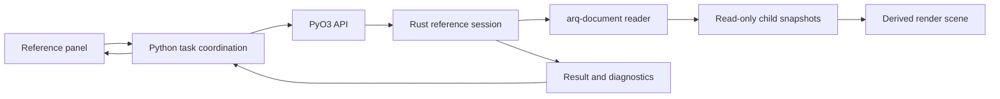

# 0026. External reference inventory, resolution and display

Date: 2026-10-22 · Status: **Proposed** · Builds on [0017](0017-dwg-dxf-engine-strategy.md),
[0018](0018-native-format.md), [0021](0021-spatial-index.md),
[0023](0023-blocks.md), and technical contract sections 1, 6–10.

## Context

Milestone 03.4 now checks synthetic Xref metadata preservation. The product
does not yet provide a public reference inventory or an external-file resolver.
The maintainer requests external validation in ProgeCAD and a loading design.
The [exercise](../../testing/progecad-xrefs.md) now has six independently
authored ProgeCAD DWGs and external reopen observations for outputs from
AcadRust 0.6.5 and 0.6.7 ([results](../../testing/progecad-xrefs-results.md)).
The baseline exposed lost unloaded state in DXF and unrepresented Xref INSERTs.
The narrow safeguards below address representation and silent loss. They do not
change this ADR's Proposed status or authorize the external-file loader.

Existing implementation anchors:

- `crates/arq-document/src/blocks.rs::Document::block_names` excludes blocks
  whose `xref_path` is nonempty. A reference inventory must also inspect flags,
  including empty or malformed paths; this filter is not an inventory API.
- `crates/arq-document/src/compatibility_tests.rs::xref_fixture_metadata_roundtrips`
  verifies paths, attachment/overlay flags and INSERT transforms through saves.
- `crates/arq-document/src/verify.rs::Document::validate_roundtrip` compares Xref
  paths, attachment/overlay and unload flags, and stored INSERT placements and
  ownership. `inventory.rs::Document::save_losses` separately compares counts.
  A changed reference fails verification even when count losses are accepted.
- `crates/arq-document/src/drawing.rs::Painter` expands local block geometry;
  its `MAX_DEPTH` is not an external-file graph traversal policy.
- `crates/arq-core/src/app.rs::CadApplication::save_document` snapshots a
  document, writes outside the lock and then records the path. External loads
  also need explicit stale-result and Save As rules.
- `python/arqstudiocad/ui/background.py::QtWorker` coordinates existing file
  tasks. No new Python/Qt dependency belongs in the Rust crates.

ADR 0023 D2 places Xref functionality in phase 04 or later. This proposal does
not change that schedule or authorize an early loader. Phase 03 work gathers
preservation evidence; later implementation follows the staged acceptance
criteria below. These are proposed contracts, not existing APIs.

## Authorized preservation and display safeguard (phase 03)

The maintainer authorized a filename marker and a save-preservation safeguard.
These narrow changes do not accept this loading proposal or move the external
resolver into phase 03.

`drawing.rs::Painter::expand_insert` draws the stored path's final filename
(falling back to the block name) through the existing built-in stroke font.
The marker has a nominal height of one model unit before the INSERT transform;
it follows array placements, scale, rotation, normal, layer visibility and
resolved color. Its text bounds support picking. No file is resolved or loaded,
no cached external geometry is expanded, and drawing does not mutate the host.
Both loaded and unloaded references receive this provisional marker; it reports
a reference's presence, not resolution success or external geometry fidelity.

Safe saving compares reference metadata and instances after reading the output.
The original AcadRust 0.6.7 pin (`955bdd8`) lost `is_xref_unloaded` in DXF, so
the safeguard refused that conversion. Native ProgeCAD 2026 exports and reopening
subsequently established that BLOCK group 71=1 is present in the file itself.
Fork `59aaf4c` retains the `1ca0ae2` explicit-marker correction; the six-DWG local corpus
and all twelve strict DWG/DXF saves now pass. The reference-level comparison
remains enabled and still refuses deliberate corruption of the marker. The
[focused investigation](../../testing/progecad-dxf-unloaded.md) records the
encoding, native observations and regression scope. The full native DXF now
converts to DWG after proving complete CELLSTYLEMAP conversion; both final formats
reopen with margins 1.5 and unloaded state intact. Legacy R2000 drawings that
lose the companion owner remain safely refused. Other applications and broader
DXF fidelity remain independent acceptance work; this does not enable loading.

## Proposed decision

### 1. Ownership and inventory

Rust owns both persistent reference metadata and derived reference caches.
`arq-document` translates codec records into owned, codec-independent values.
`arq-core` owns resolution sessions, document lifetime and committed updates;
`arq-python` exposes immutable values. Python schedules tasks and publishes
events; PySide6 displays them through the application layer.

Distinguish a reference definition from its INSERT instances. Proposed values:

| Value | Fields / meaning |
|---|---|
| Definition | Stable host-scoped id, name, exact stored path, attachment/overlay/unknown mode, persisted unloaded state, diagnostics |
| Instance | Host entity id, definition id, full finite f64 transform in radians, model/paper-space ownership |
| Resolution | Runtime canonical identity and resolved path, state, dependency edges, content fingerprint and generation |
| Diagnostic | Structured code, reference id, dependency chain and detail; localization happens in Python/UI |

Reference ids are scoped to their owning document, not global handles.
Do not infer a reference solely from a filename or silently discard invalid
records. Preserve unknown flags even when the current UI cannot interpret them.
Keep stored paths distinct from resolved paths: discovery must not mutate DWG
metadata, mark the document dirty or add undo history.

### 2. Deterministic resolution

Resolve relative paths against the directory of the file that owns the
reference, including nested references; never against the process working
directory. For a new unsaved host, report that a base directory is required.
Try an explicit absolute path as stored; try a relative or bare filename in
the owning directory. Additional search roots must be explicitly configured,
ordered and reported; do not search arbitrary disks or silently substitute a
different file with the same basename. Multiple fallback matches are ambiguous.

Use native filesystem identity for cycle/cache detection where available;
existing paths can be canonicalized, but retain the user's original spelling.
Do not lowercase all paths on Linux/macOS. Treat Windows drive/UNC syntax on
other platforms as a foreign path requiring explicit mapping, not a relative
POSIX filename. Define permission, network I/O and unsupported-format failures
as diagnostics. Do not change the working directory to load a dependency.

Traversal uses a recursion stack to detect cycles, and a separate cache for
shared dependencies; a repeated sibling is not a cycle. Keep every instance
transform even when a file snapshot is reused. Proposed initial ceilings are
32 dependency levels and 256 distinct files per root load, with explicit
limit-exceeded results; measure and review these before implementation.
Budget decoded memory as well as file size before enabling automatic traversal;
numeric memory limits remain an implementation acceptance decision.

Attachment and overlay propagation must follow the independently measured
reference graphs in ProgeCAD, including direct display versus nested display.
An unloaded reference remains inventoried but is not traversed. A missing,
damaged, unsupported or ambiguous child does not make the root appear empty
or successfully resolved. Independent sibling edges can have distinct states.

### 3. Read-only dependency graph and display

Load child documents as read-only snapshots separate from the host database.
Never copy resolved geometry into host-owned blocks just to render it.
This separation follows the existing ownership and persistence contract;
the codec remains behind `arq-document`.

Compose instance transforms through the graph in f64 model units and convert
to camera-relative rendering only at the existing renderer boundary. Do not
merge child handles, layers or spatial-index entries into host identity spaces.
Extend render identifiers to include the root instance and dependency chain
before adding child hit-testing. Initially a hit selects the host Xref instance;
editing child entities, REFEDIT and child snapping are out of the first stage.

Namespace child layers/styles. Explicitly test ByLayer/ByBlock resolution,
visibility, units, mirrored/nonuniform transforms, OCS and large coordinates.
Clip boundaries, proxy graphics and unsupported styles must be exposed as
limitations; do not claim faithful display from a bounding box alone.

### 4. Loading and reload lifecycle

Proposed states: not requested, unloaded, resolving, loaded, missing,
ambiguous, damaged, unsupported, cycle, limit exceeded, cancelled and stale.
Diagnostics are not persisted as substitute drawing objects.

Opening the host remains separate from resolving children. Run file reads on
the existing worker path; release the GIL only after review and never hold a
document mutation lock throughout disk I/O. A request carries host revision,
reference-definition revision, base directory and a load-generation token.
On completion apply only if all remain current and the host still exists;
otherwise discard the result. Closing, repathing or a newer reload invalidates
the token. Cancellation is cooperative between files; a codec read already
running need not be interruptible, but its cancelled result cannot be applied.

Reload builds a replacement off to the side and swaps the derived snapshot
atomically. On failure retain the last good snapshot as explicitly stale,
with its timestamp/fingerprint and diagnostic; never label old geometry current.
Initial load failures show diagnostics without invented geometry. A load may
report partially resolved children, but must enumerate unresolved edges.
Manual Reload comes first; automatic filesystem watching is deferred.

A successful cache swap emits a dedicated reference/render invalidation event,
not an invented geometry edit or undo step. Persistent path, mode, unload or
instance changes use Rust transactions, normal change sets and undo/redo.
No partial persistent mutation is committed on failure.

### 5. Save, Save As and fidelity guard

Ordinary Save writes the host's existing reference metadata and instances only.
Never write child files or serialize the resolved cache into the host. Reload
does not update stored paths automatically. Bind, Detach and reference editing
are separate future commands, not implicit recovery actions.

Before loader release, strengthen round-trip validation with reference-level
checks: definitions, exact stored path, flags/mode, unload state and instance
transform/identity. A dropped or changed reference must refuse a save even
when entity/table counts are identical. Add fault-injection tests for each.

For Save As to another folder, propose preserving the existing target where
possible by recomputing a relative path against the new base. Show the proposed
path changes before a persistent rewrite; allow keeping literal paths with
their resolution consequences. A same-volume/cross-volume or unresolved target
may require an absolute path or a diagnostic. Prepare changes on the save
snapshot, validate the output, and update the live metadata/base/cache only
after successful save and revision checks. A failure leaves both host metadata
and the previous file untouched. Final undo/dirty semantics for Save As path
rewrites need a focused acceptance test before this policy is enabled.

### 6. UI and implementation sequence

A separate References panel, outside the Blocks palette (ADR 0025), lists
name, mode, stored/resolved path, state and diagnostics. First controls: Refresh
inventory and Reload. Later: Choose path, unload/load and attach/detach after
transaction coverage. Strings use `tr()`; command keys remain English. No UI
calls the codec or native file mutation directly.

| Stage | Acceptance gate |
|---|---|
| A: Evidence (03.4/03.5) | Authored ProgeCAD set, source hashes, external reopen observations, explicit unsupported cases |
| B: Inventory / save guard | Stable codec-independent API; path/flags/instance round trips and deliberate corruption caught |
| C: Resolver | Relative/absolute/foreign paths, missing/unloaded, repeated children, cycles and limits tested; originals unchanged |
| D: Display | Separate child identities; transforms/style/visibility and large-coordinate comparisons against external baseline |
| E: Reload | Changed file, failed reload, close during load, stale generation and cancellation; no false dirty/undo changes |
| F: Persistent controls | Transactional repath/unload/attach, undo/redo and Save As behavior proven |

Stages B–F are proposed phase-04-or-later implementation, not completed work.
No new engine, library, dependency or platform module is introduced by this ADR.

## Consequences and open decisions

The design avoids a second persistent document model and uses existing layers,
but requires explicit derived-state invalidation and more detailed save checks.
It adds bounded I/O and cache accounting that must be measured on large files.
External evidence is required before fixing propagation and visual guarantees.
Open decisions: memory budget, cross-platform path mappings, Save As rewrite
interaction, clipped-reference support and later child snapping. Full 3D/BIM
reference federation and automatic watchers remain outside the first release.
