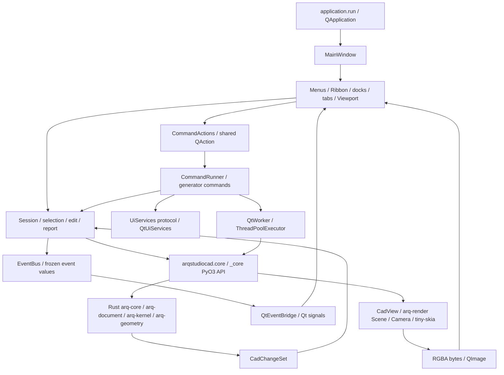

# UI architecture audit

Audit date: 2026-10-22. Static analysis only; no application launch, test run,
benchmark, dependency installation or implementation was performed.

## Scope and authority

The repository root is `D:\PROGRAMACION\ARQSTUDIOCAD\arqstudiocad`.
The audit branch is `fix/docs-roadmap-ci-sync`, created from
`feature/blocks-palette-details` at `f8b3a23` (PR #52). The working tree is
part of the evidence: eight pre-existing Rust/Python modifications add block
metadata and reference counts; two pre-existing documentation modifications
synchronize the roadmap and CI policy. These are not new completed UI features.
Sources: `git status --short --branch`, `git diff`, `git log`; block metadata
in [blocks.rs](../../crates/arq-document/src/blocks.rs), `BlockInfo` and
`Document::block_info` (lines 22 and 59 in this working tree).

This audit describes implementation, not a replacement architecture. Authority
remains with [MASTER_PLAN](../MASTER_PLAN.md), [PROJECT_CHARTER](../PROJECT_CHARTER.md),
the [technical contract](../architecture/technical-contract.md), accepted ADRs,
and [AI_AGENT_WORKFLOW](../AI_AGENT_WORKFLOW.md). In particular, ADRs 0013,
0015 and 0016 govern the shell and interactions; ADR 0024 governs 3D;
ADR 0025 remains Proposed. The [blocks design brief](../design/blocks-palette.md)
is a target rather than a description of all current controls.

Evidence labels throughout these six documents:

- **Implemented:** an executable code path was inspected, sometimes with a
  corresponding test inspected or located. It does not mean tests passed today.
- **Partial:** a working subset exists, with remaining scope identified.
- **Planned:** supported by governing documentation, without the corresponding
  integrated UI path found in the inspected tree.
- **Risk:** an inference from code; no runtime failure or performance magnitude
  is claimed without measurement.

Line numbers are navigation aids for this snapshot and may change. Symbols
and relative links identify the durable evidence.

## Layers and communication

| Boundary | Real mechanism and ownership | Evidence |
|---|---|---|
| Startup to UI | `QApplication`, application identity, settings, language, Fusion theme, one main window | [application.py](../../python/arqstudiocad/application.py), `run`:39 |
| UI to commands | One `QAction` per exposed command; menu, toolbar and Ribbon share it | [actions.py](../../python/arqstudiocad/ui/actions.py), `CommandActions`:86; [ribbon.py](../../python/arqstudiocad/ui/ribbon.py), `RibbonGroupWidget`:35 |
| Commands to application | Generators yield `Prompt` or `Background`; `CommandRunner` resumes them | [commands/__init__.py](../../python/arqstudiocad/commands/__init__.py), `Prompt`:61, `Background`:103, `CommandRunner`:324 |
| UI services | Dialog and viewport protocols, implemented by Qt adapters; commands do not import widgets | Same command module, `UiServices`:137; [qt_services.py](../../python/arqstudiocad/ui/qt_services.py), `QtUiServices`:20 |
| Python to Rust | In-process typed PyO3 calls through the public Python facade; no HTTP or JSON document transport | [core.py](../../python/arqstudiocad/core.py); [documents.rs](../../crates/arq-python/src/documents.rs), `CadDocument`:128; technical contract §§1–4 |
| Core to UI | Return change sets, then publish facts through the Python bus and Qt bridge | [session.py](../../python/arqstudiocad/session.py), `edit`:170, `report`:178; [events](../../python/arqstudiocad/events/__init__.py), `EventBus`; [event_bridge.py](../../python/arqstudiocad/ui/event_bridge.py), `QtEventBridge`:34 |
| Background to GUI | Two-worker executor, `_finished` signal, GUI-side completion callback | [background.py](../../python/arqstudiocad/ui/background.py), `QtWorker.run`:31, `_deliver`:45 |
| Document to pixels | Rust scene derived from document; CPU rasterization; Python wraps bytes and paints overlays | [view.rs](../../crates/arq-python/src/view.rs), `CadView::new`, `update`, `render`; [viewport.py](../../python/arqstudiocad/ui/viewport.py), `paintEvent`:276, `_render`:514 |

Persistent CAD state and undo history belong to Rust. Python owns session
selection, active-document coordination, command state and drafting switches.
Qt owns widgets and their visual state. `Session.report` publishes
`DocumentChanged`, optionally `ActiveLayerChanged`, and removes deleted IDs
from selection; the viewport requests selection rather than owning its policy.
Evidence: `Session.__init__`, `select`, `deselect`, `report`; `Viewport` signals
at lines 117–130; [technical contract](../architecture/technical-contract.md) §§3, 6–7.

## Window composition and lifecycle

`MainWindow.__init__` creates the command runner, action registry, docks, event
bridge, document stack, menus, status controls and workspace switcher.
`DocumentOpened` creates one `Viewport`/`CadView` per document;
`ActiveDocumentChanged` chooses its stack page; `DocumentClosed` removes the
tab and calls `deleteLater`. A separate toolbar hosts the document tab bar
above the dock areas. Source: [main_window.py](../../python/arqstudiocad/ui/main_window.py),
`__init__`:76, `_on_document_opened`:432, `_on_active_document_changed`,
`_on_document_closed`, `_show_tabs_strip`; exact component tree in
[component-inventory](component-inventory.md).

Block editing is an isolated session document linked to a parent drawing and
block name. `BEDIT` rejects dynamic definitions; `BSAVE` updates the parent
through a change set; `BlockSaved` clears the editor's displayed modified state.
The active editor reveals the contextual Ribbon tab. Evidence:
[session.py](../../python/arqstudiocad/session.py), `open_block_editor`:82,
`save_block`:104; [commands/blocks.py](../../python/arqstudiocad/commands/blocks.py),
`bedit`:102; `MainWindow._on_active_document_changed`, `_update_tab_titles`.

## Rendering and threading limits

`arq-render::Scene` stores derived drawing entries, with an ID index. Its
`update` changes individual entities, but layer/document changes rebuild the
scene. `Camera` handles the plan-view transform in Rust. `raster::render`
clips geometry and paints with tiny-skia. `CadView` protects scene/camera with
a mutex and releases the GIL for scene building, updates and rasterization.
Evidence: [scene.rs](../../crates/arq-render/src/scene.rs), `Scene::build`:26,
`update`:43; [camera.rs](../../crates/arq-render/src/camera.rs), `Camera`:16;
[raster.rs](../../crates/arq-render/src/raster.rs), `render`; `CadView` in `view.rs`.

Releasing the GIL does **not** move a call off the GUI thread. Initial
`CadView` construction, `Viewport.apply` and dirty-image rendering are called
synchronously by GUI handlers. Hover/selection avoid rerasterizing the base
image, but `_draw_outlines` does iterate over returned polylines and points in
Python. Therefore the claim that no Python runs per entity applies to the
base rasterization path, not every overlay path. Evidence:
`MainWindow._on_document_opened`, `_on_document_changed`;
`Viewport.paintEvent`:276, `_draw_outlines`:502, `_render`:514.

Normal OPEN/SAVE use background work, with Rust open/save releasing the GIL.
The runner refuses commands while busy, panels/overlays are disabled and the
status shows an indeterminate progress bar. Work cannot be interrupted.
Quitting instead calls synchronous `Session.save` inside `_save_on_quit`.
Evidence: [builtin.py](../../python/arqstudiocad/commands/builtin.py), `open_file`:67,
`_save_to`:161; `CommandRunner._run_background`, `_refuse_while_busy`, `cancel`;
`MainWindow._on_work_started`, `_on_work_finished`, `closeEvent`, `_save_on_quit`;
`documents.rs`, `open_document`:57 and helper `save`:115.

## Current and future capabilities

The inspected executable shell provides 2D drafting, blocks, text, properties,
history, docking and CPU plan views. GPU backend probing exists as an isolated
subprocess utility, but the inspected startup/viewport paths do not select it
as the drawing renderer. Shaded 3D awaits milestone 02.7; solids can have
plan-view edges/isolines under ADR 0024. Do not prototype an implemented 3D
orbit, BIM workspace or associative sheet editor from roadmap text alone.
Evidence: [gpu.py](../../python/arqstudiocad/gpu.py), `probe_backend`,
`first_available_backend`; `Viewport.__init__` uses `CadView`;
[roadmap](../MODULES_AND_ROADMAP.md) §§02–09; [ADR 0024](../architecture/adr/0024-3d-document-model.md).

Plugin and scripting package entry modules contain docstrings rather than a
plugin loader or automation console. Workspace declaration data supports
extension, but only CAD is registered by `builtin_workspaces`. Evidence:
[plugins/__init__.py](../../python/arqstudiocad/plugins/__init__.py),
[scripting/__init__.py](../../python/arqstudiocad/scripting/__init__.py),
[workspaces.py](../../python/arqstudiocad/workspaces.py), `builtin_workspaces`:196.

## Coverage and limitations

All UI Python modules were inventoried recursively; the concrete shell,
viewport, workspace, docking, panel, command, styling, translation and dialog
paths were inspected. Supporting evidence includes the Python session/event
modules, command generators, Rust view/scene/camera/raster sources, public
binding changes, icon mapping/resources, CI configuration, README and governing
documents. The remaining five audit files provide symbol-level references.

Test code was inspected for viewport selection overlays, event-thread delivery,
Ribbon structure and folding, and block palette toggles. Additional test
functions were located for documents, themes, docking, colors, commands and
properties; locating a test is weaker evidence than executing it. Sources:
[test_selection.py](../../tests/python/test_selection.py),
[test_events.py](../../tests/python/test_events.py),
[test_workspaces.py](../../tests/python/test_workspaces.py),
[test_blocks_palette.py](../../tests/python/test_blocks_palette.py).

No screenshots were captured or compared, no accessibility tree was evaluated,
and no cross-platform runtime behavior, frame time, memory usage or test pass
status was verified. Existing design PNGs are proposals. This is an interface
audit, not an exhaustive numerical, codec, kernel or packaging audit. Future
proposals in these documents require explicit authorization before code changes.

Deliverable verification was read-only: six requested Markdown files, local
link-target existence, whitespace/newline/conflict-marker checks, and comparison
of the tracked diff before and after writing. Existing tracked changes remained
byte-for-byte identical. These checks validate the documents' packaging, not
application behavior or the semantic correctness of every source reference.
