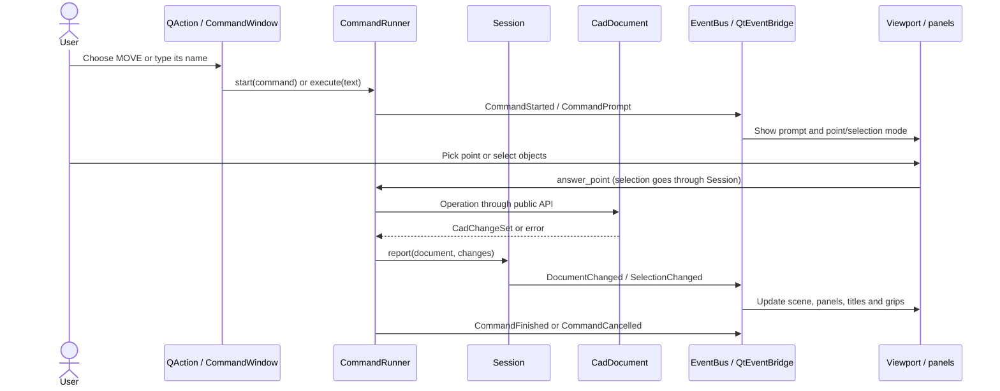

# UI interactions

Static behavior specification, 2026-10-22. Evidence and limitations are in
[architecture](architecture.md). This records the current application; future
Blocks-palette interactions are separated explicitly below.

## Shared command lifecycle

Evidence: [actions.py](../../python/arqstudiocad/ui/actions.py), `CommandActions.run`:106;
[commands/__init__.py](../../python/arqstudiocad/commands/__init__.py),
`CommandRunner.execute`:355, `start`:375, `_advance`, `_show`, `_fail`;
[session.py](../../python/arqstudiocad/session.py), `report`:178;
[main_window.py](../../python/arqstudiocad/ui/main_window.py), `_on_command_prompt`,
`_on_document_changed`, `_on_selection_changed`.

## Input and navigation

| Gesture / input | Actual transition | Evidence |
|---|---|---|
| Wheel | Zoom factor `1.25 ** (angleDelta.y / 120)` around physical cursor coordinates; preserves world point under cursor | [viewport.py](../../python/arqstudiocad/ui/viewport.py), `wheelEvent`:292 |
| Middle drag | Closed-hand cursor; pan by logical delta times device-pixel ratio; release restores cross cursor | `mousePressEvent`:301, `mouseMoveEvent`:325, `mouseReleaseEvent`:347 |
| Middle double-click | Zoom extents | `mouseDoubleClickEvent`:368 |
| Left click, idle | Pick nearest eligible geometry within aperture, add to session selection | `pick_at`:396, `mouseReleaseEvent`:347; `MainWindow._on_document_opened` wiring |
| Shift + click/drag | Remove found IDs from selection | Same release handler, `Session.deselect`:153 |
| Left-to-right drag | Blue solid window; selects wholly contained objects | `select_in`:402, `_paint_overlay`:436 |
| Right-to-left drag | Green dashed crossing; selects touched objects | Same methods |
| Mouse hover, idle | Pick highlight; overlay repaint, no base-image invalidation | `_set_hover`:431, `_paint_overlay`:436 |
| Click during point prompt | Snap first; otherwise ORTHO when enabled and base exists; otherwise raw world point; emit `point_picked` | `_aim`:410, `mousePressEvent`:301 |
| Click a grip, idle | Emit `grip_clicked`; MainWindow starts a GRIP command; hot grip red | `grip_at`:257, `show_grips`:251; `MainWindow._edit_grip`; [grips.py](../../python/arqstudiocad/commands/grips.py), `grip_edit`:59 |
| Printable key/Enter in viewport | Copy event to command input, show command dock and give it focus | `keyPressEvent`:375; [command_window.py](../../python/arqstudiocad/ui/command_window.py), `type_key`:99 |
| Esc | Clear selection band, cancel command, clear typed input and selection; background work refuses cancellation | `Viewport.keyPressEvent`; `CommandWindow.escape`:89; `CommandRunner.cancel`:392 |

Command input: Enter submits; Space submits except free-text prompts; Up/Down
recall at most 100 typed lines; inline command completion is case-insensitive
and detached while answering a prompt. Empty input when idle repeats the last
repeatable command. Names and English aliases remain usable in Spanish, with
localized names added through catalogs. Absolute/relative/polar/direct-distance
point input is handled by the application parser, not by the widget.
Evidence: `CommandWindow.__init__`, `_send`, `_on_prompt`, `eventFilter`:130;
`CommandRunner.execute`, `_answer_point`; [points.py](../../python/arqstudiocad/points.py),
`parse_point`; [i18n](../../python/arqstudiocad/i18n/__init__.py), `fold_name`,
`localized_commands`.

## Command tool behavior

These are current generators, not promises of all AutoCAD options. Each row
names its implementation; the registry lives at the end of the linked module.

| Tool | Current workflow | Evidence |
|---|---|---|
| NEW / OPEN | New empty drawing; OPEN chooses DWG/DXF then background read, adopts result, reports recovery/unknown objects | [builtin.py](../../python/arqstudiocad/commands/builtin.py), `new`:44, `open_`:51, `open_file`:67 |
| SAVE / SAVEAS / CLOSE | Save current path or choose destination; background write with loss/recovery questions; CLOSE asks Save/Discard/Cancel for modifications | Same module, `save`:108, `save_as`:119, `_save_to`:161, `close`:234 |
| UNDO / REDO | One core history operation reported through Session | Same module, `undo`:264, `redo`:275 |
| ZOOM / ID | ZOOM Extents/In/Out; ID asks a point and reports coordinates | Same module, `zoom`:286, `id_`:303 |
| LAYER / BLOCKSPALETTE | Open/raise respective panel; Blocks action also has explicit toggle-close behavior | Same module, `layer`:311, `blocks_palette`:320; `MainWindow._palette_button` |
| LINE | Repeated points, Undo/Close options, Enter finishes; Esc keeps drawn segments as one undo group | [draw.py](../../python/arqstudiocad/commands/draw.py), `line`:49 |
| PLINE | Straight and tangent-arc segments; Arc/Line/Undo/Close; Esc keeps accumulated polyline | Same module, `pline`:89 |
| CIRCLE | Center/radius or diameter; two-point diameter or three-point circle | Same module, `circle`:163 |
| ARC | Three points or center/start/end variants; counterclockwise core convention | Same module, `arc`:202 |
| TEXT | Start, height, rotation, repeated text lines until empty input; grouped undo | Same module, `text`:257 |
| MTEXT | Two corners with Height/Justify/Rotation options, then plain multiline dialog; wrapped text | Same module, `mtext`:288; [text_dialog.py](../../python/arqstudiocad/ui/text_dialog.py), `ask_text`:43 |
| ERASE / EXPLODE | Current or prompted selection, filtering locked layers; EXPLODE accepts only block references, retaining attribute values as texts under ADR 0023 | [modify.py](../../python/arqstudiocad/commands/modify.py), `select_objects`:38, `erase`:65, `explode`:73 |
| MOVE / COPY | Base and second point; MOVE Enter uses displacement; COPY repeats placements with Undo and grouped history | Same module, `move`:90, `copy`:109 |
| ROTATE / SCALE | Selection, base, angle in degrees or direction point; scale factor or distance | Same module, `rotate`:144, `scale`:163; runner converts numeric degrees to radians |
| MIRROR | Two axis points, optional source removal (default keeps sources) | Same module, `mirror`:176 |
| BLOCK | Name, base, selection; creates definition and replaces objects with a reference | [blocks.py](../../python/arqstudiocad/commands/blocks.py), `block`:28 |
| INSERT | Existing-name chooser, insertion point, Scale/Rotate options and moving outline; cancellation rolls back temporary insertion | Same module, `insert`:49; no Explode option yet |
| BEDIT / BSAVE / BCLOSE | Choose static block, separate editor tab, save to parent or close with modification handling | Same module, `bedit`:102, `bsave`:127, `bclose`:133, `save_block`:138, `close_block_editor`:154 |

## Docks, tabs, panels and dialogs

Pinned side panels can move, float or form tab groups. Unpinning reparents
contents into an overlay and replaces the dock with a side tab. Hover/click
opens it; another overlay replaces it; leaving collapses it on the 400 ms
timer unless a child has keyboard focus. Clicking outside collapses it.
Floating docks cannot be unpinned. The CommandWindow is dockable but is not
one of AutoHide's managed panels. Evidence:
[auto_hide.py](../../python/arqstudiocad/ui/auto_hide.py), `unpin`:236,
`expand`:315, `_check_leave`:376, `eventFilter`:394;
`MainWindow.__init__` passes only the four side panels to `AutoHide`.

Layer edits, property edits and history navigation run through Session and
publish change sets. Refused edits report a command message and restore the
display from document state. Geometry/property angles display degrees; the
public core API uses radians. Properties distinguish mixed selections with
`*Varies*`; folded sections survive refresh in memory.
Evidence: [layers_panel.py](../../python/arqstudiocad/ui/layers_panel.py), `_edit`;
[properties_panel.py](../../python/arqstudiocad/ui/properties_panel.py),
`selection_properties`:84, `_edit_property`:514, `_edit_geometry`:550,
`_edit_text`:563; [property_grid.py](../../python/arqstudiocad/ui/property_grid.py),
`show_sections`:227, `_remember`:338; [history_panel.py](../../python/arqstudiocad/ui/history_panel.py), `go_to`:72.

The color dialog supports index or RGB selection, search, session recent colors
and OK/Cancel. Layers use a quick-color menu before the full dialog. File
recovery, overwriting damaged input and lossy output have dedicated questions.
Save As currently lists DXF before DWG. Evidence:
[color_picker.py](../../python/arqstudiocad/ui/color_picker.py), `ColorPickerDialog`:130;
`LayersPanel._on_click`, `_pick_color`; [qt_services.py](../../python/arqstudiocad/ui/qt_services.py),
`choose_save_path`:41, `report_recovered`:68, `ask_overwrite_damaged`:84,
`ask_accept_losses`:108. DWG being the strategic working format does not
change the inspected dialog's current filter ordering.

## Shortcuts and persistence

| Input | Current binding | Source |
|---|---|---|
| New/Open/Save/Save As/Close/Undo/Redo/Delete/Quit | Qt `StandardKey`, resolved per platform; do not assume identical Ctrl bindings everywhere | `actions.py`, `SHORTCUTS`; `MainWindow.__init__` Exit action |
| Ctrl+3 | Blocks palette | `actions.py`:29 |
| F3 / F8 | OSNAP / ORTHO, window shortcuts | `DraftingBar.__init__`:21 |
| Ctrl+1 / PROPERTIES / PR | Proposed by ADR 0025, absent from current action/command registries | `actions.SHORTCUTS`; `builtin.BUILTIN_COMMANDS`; [ADR 0025](../architecture/adr/0025-blocks-palette.md), D2 |
| Ctrl+2 | No binding in inspected command actions; reserved free by proposed ADR | Same sources |

Settings-backed values are `language`, `theme`, `recent_files`,
`workspace/discipline`, `workspace/<discipline>/layout`,
`workspace/<discipline>/<layout>/state`, and `panels/auto_hidden`.
The auto-hide list is global, whereas dock/toolbar state is workspace-specific.
There is no observed settings key for drafting switches, property folds,
Ribbon folded state, recent colors, dialog last folder, window geometry or
reopening documents. These live in memory or have no inspected persistence path.
Evidence: `application.open_settings`; `MainWindow.change_language`, `change_theme`;
`WorkspaceSwitcher.save_state`, `AutoHide._save`; `RecentFilesMenu._changed`;
`Drafting.__init__`; `PropertyGrid.folded`; `ColorPickerDialog` module recent-color
storage; `QtUiServices.last_folder`; `Ribbon._folded`.

## Future Blocks palette interactions

Three sources, preview grid/list, dynamic tags, Selected block/Insert options,
palette Insert/Edit/New, drag/drop, cross-document copying and clash resolution
are targets in [ADR 0025](../architecture/adr/0025-blocks-palette.md), D1–D9.
Current `BlocksPanel` has only name filtering, a list and footer. The uncommitted
metadata bindings do not add those controls. A faithful current-state prototype
must keep them out of its baseline; a separate proposal may demonstrate them
with clear labels and without claiming Rust support.
